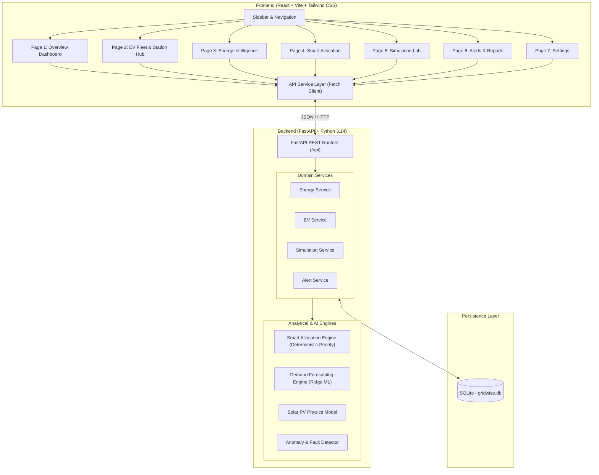

# GRIDWISE AI – SYSTEM ARCHITECTURE

## 1. Architecture Overview

GRIDWISE AI is engineered as a lightweight, local-first decision support system for smart grid operators, municipal facility managers, and university campus microgrids.

---

## 2. Allocation Hierarchy & Invariant Guarantees

The core of GRIDWISE AI is the **Smart Allocation Engine** (`backend/algorithms/allocation.py`).

### Hierarchical Priority Tiers:
1. **Tier 1: Critical Campus Loads** (Emergency clinic, BioTech cold chain storage, IT core infrastructure).
2. **Tier 2: Essential Building Services** (Academic classroom lighting/power, student dormitories).
3. **Tier 3: Urgent EV Charging** (Electric campus emergency responders, security cruisers, imminent departure vehicles).
4. **Tier 4: Flexible EV Charging** (Commuter students & staff with &gt;5h dwell times).
5. **Tier 5: Optional Consumption** (Athletic complex cooling, architectural decorative lighting).

### Mathematical Invariants:
$$P_{\text{allocated}} \le P_{\text{supply}} = P_{\text{grid}} + P_{\text{solar}}$$
$$\text{Deficit} = \max(0, P_{\text{demand}} - P_{\text{supply}})$$

If $P_{\text{demand}} > P_{\text{supply}}$, loads are curtailed in reverse priority order: Tier 5 is shed first, followed by Tier 4 throttling/deferral, Tier 3 throttling, Tier 2 reduction, and lastly Tier 1 alert.
Allocated power **never** exceeds available supply.

---

## 3. Machine Learning & Physical Modeling

### Demand Forecasting Engine:
- **Architecture**: Autoregressive Ridge Regression with cyclic harmonic transforms.
- **Feature Vector**:
  $$\vec{x} = \left[\sin\left(\frac{2\pi h}{24}\right), \cos\left(\frac{2\pi h}{24}\right), \text{DoW}, \text{Weekend}, T_{\text{ambient}}, P_{\text{solar}}, P_{\text{EV}}, L_{t-1}, L_{t-24}\right]$$
- **Output**: Point load forecast, 95% confidence intervals ($\pm 1.96\sigma$), and peak demand warning flags ($>900\text{ kW}$).

### Solar PV Physics Engine:
- Models solar elevation angle, clear-sky irradiance, and atmospheric cloud cover.
- Temperature coefficient derating:
  $$P_{\text{pv}} = P_{\text{STC}} \cdot \left(\frac{G}{1000\text{ W/m}^2}\right) \cdot \left[1 - \gamma \cdot \max(0, T_{\text{cell}} - 25^\circ\text{C})\right]$$
  where $\gamma = 0.004\text{ /}^\circ\text{C}$ (empirical silicon thermal derating).
